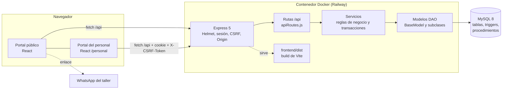
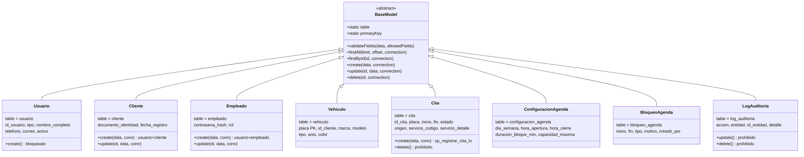
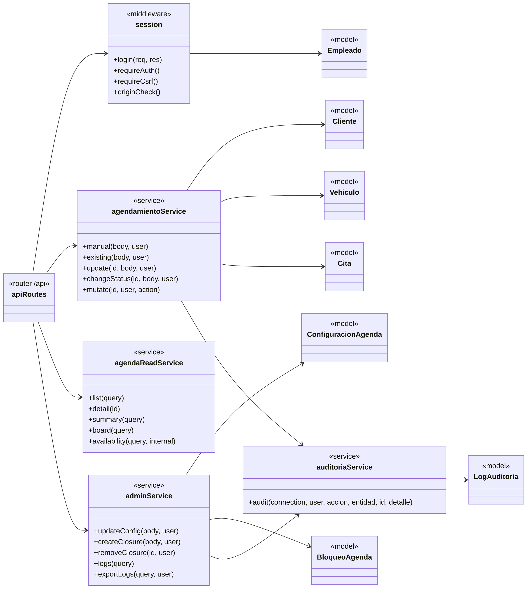
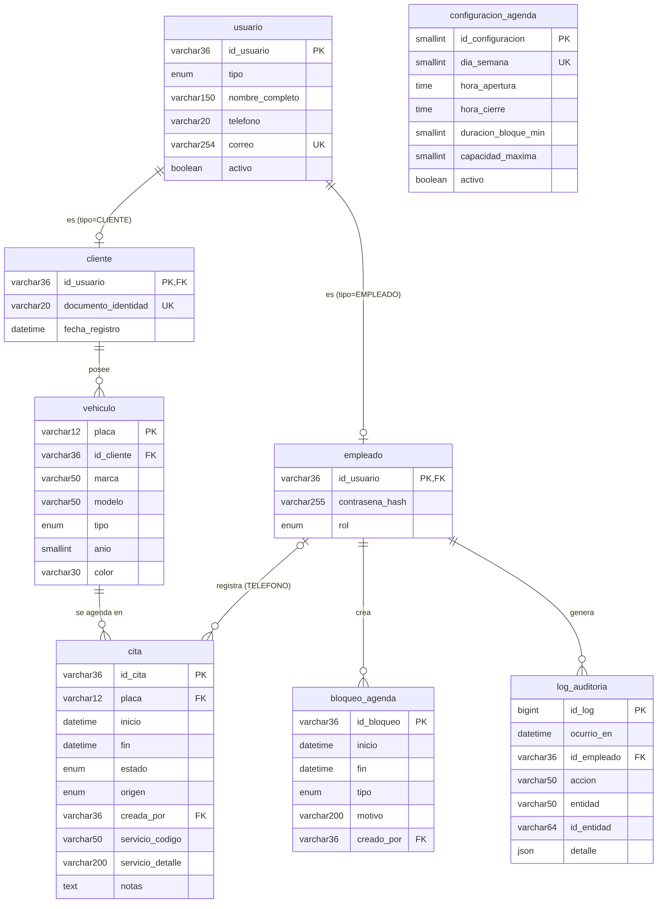

# Manual técnico — Sistema de Reservas Grupo Bautista (V7.1)

Documento para el equipo técnico que reciba el proyecto: cómo está construido, cómo instalarlo, desplegarlo, mantenerlo y extenderlo.

| Dato | Valor |
|---|---|
| Repositorio | https://github.com/alissonraquelh-glitch/SistemaRESERVAS_KeyTechInc |
| Rama principal | `main` |
| Versión | V7.1 (mejoras de retroalimentación del cliente, PR #11) |
| Tipo de aplicación | Aplicación web (SPA React + API REST Node.js) con base de datos MySQL |
| Despliegue previsto | Contenedor Docker en Railway (ver sección 8) |

**Contenido:** 1. Descripción general · 2. Arquitectura · 3. Tecnologías y justificación · 4. Diagrama de clases · 5. Base de datos y persistencia (DAO) · 6. Instalación local · 7. Pruebas · 8. Despliegue · 9. Estructura del repositorio · 10. Cómo agregar una funcionalidad · 11. API · 12. Seguridad · 13. Limitaciones y mejoras pendientes

---

## 1. Descripción general

El sistema administra la agenda de citas del taller Grupo Bautista (San Miguel, El Salvador):

- **Portal público** (sin cuenta): consulta disponibilidad en tiempo real y prepara una solicitud por WhatsApp. **No escribe en la base de datos.**
- **Portal del personal** (`/personal`, con sesión): Secretaría registra y gestiona citas; Jefe de taller mueve vehículos en un tablero Kanban; Administración configura horarios, capacidad, cierres y consulta la auditoría.
- **Auditoría inmutable** de toda operación de escritura.

Roles (`empleado.rol`): `SECRETARIA`, `JEFE_TALLER`, `ADMIN`, `DUENO`. `SECRETARIA`, `ADMIN` y `DUENO` forman el grupo `MANAGERS` (`src/middleware/session.js`); `JEFE_TALLER` solo accede al tablero y al cambio de estado.

La zona horaria de negocio es `America/El_Salvador` (UTC−6, sin horario de verano). Las fechas se guardan como `DATETIME` en hora civil del taller.

---

## 2. Arquitectura

Arquitectura en capas, monorepo con dos paquetes npm (`src/` backend y `frontend/`):



| Capa | Ubicación | Responsabilidad |
|---|---|---|
| Presentación | `frontend/src/` | SPA React. `features/` por módulo funcional, `context/` para estado global (sesión, agenda, avisos), `services/api/` cliente HTTP, `adapters/` traduce el formato de la API al de la UI. |
| Entrada HTTP | `src/app.js`, `src/middleware/` | Cabeceras de seguridad (Helmet), JSON ≤ 64 KB, sesión firmada, verificación de `Origin`, CSRF, roles y manejo de errores. |
| Rutas | `src/routes/` | `apiRoutes.js` define los endpoints `/api/*` y aplica `requireAuth`, `requireRoles` y `requireCsrf`. |
| Servicios de dominio | `src/services/` | Reglas de negocio: validación, transacciones, permisos por estado, auditoría. |
| Persistencia (DAO) | `src/models/`, `src/lib/transaction.js` | Acceso a datos con SQL parametrizado y procedimientos almacenados. |
| Base de datos | `db/` | Esquema MySQL, restricciones `CHECK`, triggers y procedimientos transaccionales. |

En producción **un solo proceso** Express sirve la API en `/api` y los archivos estáticos compilados de `frontend/dist`, con *fallback* a `index.html` para las rutas de React. En desarrollo, Vite (`:5173`) sirve el frontend y redirige `/api` al backend (`:3000`).

**Flujo de una petición de escritura** (ejemplo: registrar cita manual):
`ManualBookingModal` → `AgendaContext` → `services/api/client.js` (`POST /api/citas/manuales` + cookie + `X-CSRF-Token`) → `session` / `originCheck` / `requireCsrf` / `requireRoles` → `agendamientoService.manual()` → `transaction()` → `Cliente` / `Vehiculo` / `Cita.create()` (`sp_registrar_cita_tx`) → `audit()` → `COMMIT`.

---

## 3. Tecnologías y justificación

| Tecnología | Versión | Uso | Justificación |
|---|---|---|---|
| Node.js | 22.12+ | Runtime del backend y del build | LTS, mismo lenguaje en cliente y servidor. |
| Express | 5 | API REST y servidor estático | Mínimo y conocido; Express 5 propaga errores de funciones `async` al manejador central. |
| mysql2/promise | 3 | Driver MySQL con pool | Consultas parametrizadas (evita inyección SQL), soporte de procedimientos y transacciones. |
| MySQL / InnoDB | 8.0.16+ | Persistencia | Transacciones ACID, bloqueos de fila, `CHECK` (desde 8.0.16), triggers y procedimientos para garantizar la capacidad sin sobre-reservas. |
| cookie-session | 2 | Sesión firmada en cookie | Sin almacenamiento de sesión en servidor; adecuado para un solo contenedor. Cookie `bookit.sid`, `HttpOnly`, `SameSite=Lax`, `Secure` en producción, `path=/api`, 8 h. |
| bcryptjs | 3 | Hash de contraseñas | Implementación pura en JS (sin compilación nativa en Docker). |
| Helmet | 8 | Cabeceras de seguridad y CSP | Estándar de facto para Express. |
| React | 18 | Interfaz | Componentes reutilizables y amplio ecosistema. |
| Vite | 8 | Dev server y build | Arranque rápido y build optimizado. |
| React Router | 7 | Rutas `/` y `/personal` | SPA con recarga directa de rutas. |
| Tailwind CSS | 3 | Estilos | Utilidades consistentes sin hojas CSS grandes. |
| Playwright | 1.x (dev) | Prueba E2E de humo | Navegador real contra el build de producción. |
| Docker | — | Empaquetado | Imagen reproducible para Railway u otro proveedor. |

---

## 4. Diagrama de clases (producto final)

### 4.1 Capa de persistencia

Todos los modelos heredan de `BaseModel`, que implementa el CRUD genérico a partir de `static table` y `static primaryKey`. Las subclases restringen o reemplazan operaciones según las reglas del dominio.



| Clase | Particularidad |
|---|---|
| `Usuario` | `create()` bloqueado: los usuarios se crean solo como `Cliente` o `Empleado`. |
| `Cliente`, `Empleado` | `create()`/`update()` escriben en `usuario` y en su tabla en la misma transacción (especialización por `(id_usuario, tipo)`). |
| `Vehiculo` | Clave natural `placa`. |
| `Cita` | `create()` llama a `sp_registrar_cita_tx` (valida capacidad y cierres) y guarda `servicio_detalle` en la misma transacción; `delete()` prohibido (se cancela). |
| `ConfiguracionAgenda`, `BloqueoAgenda` | Horario semanal y cierres. |
| `LogAuditoria` | `update()` y `delete()` prohibidos. |

### 4.2 Servicios y dependencias



| Módulo | Funciones principales |
|---|---|
| `agendamientoService` | `manual`, `existing`, `update`, `changeStatus`, `mutate`; validadores `citaInput`, `clientInput`, `vehicleInput`. |
| `agendaReadService` | `list` (filtros, orden y paginación), `detail`, `summary`, `board` (rangos del tablero), `availability`, `configurations`. |
| `adminService` | `updateConfig`, `listClosures`, `createClosure`, `removeClosure`, `logs`, `exportLogs`. |
| `auditoriaService` | `audit(connection, user, accion, entidad, id, detalle)` dentro de la transacción del cambio. |
| `src/lib/` | `agenda.js` (fechas civiles y rangos), `validation.js`, `errors.js` (`AppError` y mapeo de errores SQL), `auditExport.js` (CSV seguro), `transaction.js`, `origins.js`. |

Las fuentes editables de los diagramas están en `docs/diagramas/*.mmd` (Mermaid). Para regenerarlos: `npx @mermaid-js/mermaid-cli -i docs/diagramas/er.mmd -o docs/diagramas/er.png -s 2 -b white`.

---

## 5. Base de datos y capa de persistencia

### 5.1 Modelo entidad-relación



| Tabla | Propósito | Reglas clave |
|---|---|---|
| `usuario` | Datos comunes de personas | `tipo` ∈ {CLIENTE, EMPLEADO}; `correo` único. |
| `cliente` | Especialización cliente | `documento_identidad` único. |
| `empleado` | Especialización empleado | `contrasena_hash` (bcrypt) y `rol`. |
| `vehiculo` | Vehículos | PK `placa`; `modelo` obligatorio, `marca` opcional; FK a cliente. |
| `cita` | Citas | `fin > inicio`; `origen=WEB ⇒ creada_por NULL`, `TELEFONO ⇒ creada_por NOT NULL`; `servicio_detalle VARCHAR(200)` para `OTROS`; índice `(inicio, estado)`. |
| `configuracion_agenda` | Horario por día de semana (0–6) | Apertura, cierre, minutos por bloque, capacidad máxima. |
| `bloqueo_agenda` | Cierres de agenda | Rango de fechas y motivo público. |
| `log_auditoria` | Auditoría | Triggers impiden `UPDATE` y `DELETE`. |

### 5.2 Patrón DAO en este proyecto

No existe una carpeta llamada `dao`: **los modelos de `src/models/` cumplen el rol de DAO** (objetos de acceso a datos). Cada modelo encapsula una tabla y expone métodos estáticos; los servicios nunca construyen SQL con datos del usuario sin parámetros.

- `BaseModel` (`src/models/BaseModel.js`): `findAll({limit, offset})`, `findById`, `create`, `update`, `delete`, `validateFields` (lista blanca de columnas). Todos aceptan un parámetro `connection` opcional para participar en una transacción; por defecto usan el pool.
- Lecturas complejas (listados con filtros, tablero, disponibilidad, auditoría) usan SQL parametrizado directamente en `agendaReadService` y `adminService`, porque combinan varias tablas.
- `src/lib/transaction.js`:
  - `transaction(callback)`: obtiene una conexión, fija `READ COMMITTED`, ejecuta `callback(connection)` y hace `COMMIT` o `ROLLBACK`.
  - `lockDays(connection, days)`: bloquea con `SELECT … FOR UPDATE` las filas de `configuracion_agenda` de los días afectados, en orden estable, para serializar escrituras sobre el mismo día y evitar sobre-reservas e interbloqueos.
- Procedimientos (`db/routines.v6.sql`): `sp_validar_intervalo_tx` y `sp_registrar_cita_tx` validan horario, cierres y capacidad dentro de la transacción. Señalan errores `30002` (cupo lleno) y `30003` (agenda cerrada), que `errors.js` traduce a HTTP 409.
- Pool (`src/config/database.js`): `connectionLimit 10`, `dateStrings: true`, `timezone "-06:00"` y `SET time_zone = '-06:00'` en cada conexión.

### 5.3 Scripts SQL

| Archivo | Cuándo usarlo |
|---|---|
| `db/DataBase(1).sql` | Instalación nueva: crea tablas, triggers y procedimientos. Ya incluye `servicio_detalle`. |
| `db/routines.v6.sql` | Recrear solo procedimientos (usa `DELIMITER`, ejecutar con el cliente `mysql`). |
| `db/migrations/002_v6.sql` | Actualizar bases anteriores a V6. |
| `db/migrations/003_servicio_detalle.sql` | Actualizar bases V6/V7.0 a V7.1 (idempotente, solo agrega la columna). |
| `db/seed.demo.sql`, `db/seed.empleados.demo.sql` | **Solo desarrollo/demostración.** Nunca en producción. |

---

## 6. Instalación y ejecución local

### 6.1 Requisitos

- Node.js **22.12 o superior** y npm.
- MySQL **8.0.16 o superior** (local o en Docker).
- Git. Opcional: Docker.

### 6.2 Pasos

```bash
# 1. Clonar
git clone https://github.com/alissonraquelh-glitch/SistemaRESERVAS_KeyTechInc.git
cd SistemaRESERVAS_KeyTechInc

# 2. Dependencias
npm ci --prefix src
npm ci --prefix frontend

# 3. Base de datos (ejemplo con Docker; omitir si ya tiene MySQL)
docker run -d --name bookit-mysql -e MYSQL_ROOT_PASSWORD=cambiar -p 127.0.0.1:3306:3306 mysql:8.4   # solo loopback
mysql -h 127.0.0.1 -u root -p -e "CREATE DATABASE bookit CHARACTER SET utf8mb4 COLLATE utf8mb4_0900_ai_ci"
mysql -h 127.0.0.1 -u root -p bookit < "db/DataBase(1).sql"
# Opcional, datos de demostración (solo local):
mysql -h 127.0.0.1 -u root -p bookit < db/seed.demo.sql
mysql -h 127.0.0.1 -u root -p bookit < db/seed.empleados.demo.sql
```

**4. Variables de entorno.** El backend lee un archivo `.env` en la **raíz** del repositorio (no versionado; no hay plantilla en la raíz, créelo a mano):

```dotenv
DB_HOST=127.0.0.1
DB_PORT=3306
DB_USER=root
DB_PASSWORD=cambiar
DB_NAME=bookit
PORT=3000
SESSION_SECRET=<cadena aleatoria de al menos 32 caracteres>
APP_ORIGINS=http://localhost:5173
# NODE_ENV=production   # solo en producción
# TRUST_PROXY=1         # solo detrás de un proxy HTTPS (Railway)
```

El frontend tiene `frontend/.env.example` (`VITE_API_BASE_URL=/api`, `VITE_API_BACKEND_URL=http://localhost:3000`); copiarlo a `frontend/.env` solo si necesita cambiar esos valores.

> El backend usa `DB_HOST`, `DB_PORT`, `DB_USER`, `DB_PASSWORD` y `DB_NAME`. **No lee `DATABASE_URL`.**

**5. Crear el primer empleado** (si no cargó los datos demo). El script lee JSON por la entrada estándar y nunca recibe la contraseña como argumento:

```bash
# Crear el archivo con un editor (no con echo) para que la contraseña no quede en el historial de la terminal
umask 077 && nano empleado.json
# {"nombre_completo":"Ana Admin","telefono":"70000000","correo":"admin@taller.com","rol":"ADMIN","password":"<min 8 caracteres>"}
npm run provision:employee --prefix src < empleado.json
shred -u empleado.json   # o rm empleado.json
```

Roles válidos: `SECRETARIA`, `JEFE_TALLER`, `ADMIN`, `DUENO`.

**6. Ejecutar** (dos terminales):

```bash
npm run dev --prefix src        # API en http://localhost:3000
npm run dev --prefix frontend   # UI en http://localhost:5173
```

**7. Primer uso.** Abra `http://localhost:5173/personal`, inicie sesión y en **Administración → Horarios y capacidad por día** guarde los siete días (sin eso no se pueden registrar citas).

Comprobación rápida: `curl http://localhost:3000/api/health` debe responder `{"data":{"ok":true}}`.

### 6.3 Ejecutar como en producción

```bash
npm run build --prefix frontend
NODE_ENV=production node src/app.js   # sirve UI y API en :3000
# o con Docker:
docker build -t bookit .
docker run -p 3000:3000 --env-file .env -e NODE_ENV=production bookit
```

---

## 7. Pruebas

| Comando | Qué valida | Requisitos |
|---|---|---|
| `npm test --prefix src` | Unitarias: fechas y rangos, validaciones, CSV, seguridad. | Ninguno. |
| `npm run test:integration --prefix src` | API completa contra MySQL real (citas, capacidad, permisos, auditoría, exportación). | Variables `DB_*` apuntando a una base **desechable**; el nombre debe cumplir `bookit_v6_*test` (por ejemplo `bookit_v6_test`) o la suite se niega a ejecutar. Nunca contra producción. |
| `npm run test:e2e --prefix frontend` | Humo E2E en navegador del build de producción (CSP, estados, cierres, modal, navegación SPA) a 1440 px y 390 px, con base simulada. | `npm run build --prefix frontend`; Microsoft Edge instalado, o `npx playwright install chromium` y `E2E_BROWSER_CHANNEL=chromium`. |
| `npm run build --prefix frontend` | Compilación del frontend. | — |

---

## 8. Despliegue

### 8.1 Dónde está desplegado

- **Plataforma prevista:** Railway, proyecto `serene-growth`, servicio `SistemaRESERVAS_KeyTechInc`, construido desde el `Dockerfile` de la rama `main`.
- **Estado al cierre de V7.1:** el servicio **no está operativo**; no tiene una base MySQL conectada ni variables configuradas. La configuración quedó a cargo del responsable de Railway del equipo. **URL pública: pendiente**; cuando exista, debe agregarse aquí y en el manual de usuario.

### 8.2 Cómo funciona el build

El `Dockerfile` (`node:22-bookworm-slim`) instala dependencias de `src` (solo producción) y `frontend`, compila el frontend con Vite, fija `NODE_ENV=production` y ejecuta `node src/app.js`. Railway despliega automáticamente cada push a `main`.

### 8.3 Pasos para configurar Railway (base nueva)

1. En el proyecto, **New → Database → MySQL**.
2. Cargar el esquema: conectarse con el cliente `mysql` usando las credenciales públicas del servicio MySQL y ejecutar `db/DataBase(1).sql`. **No** cargar los seeds demo.
3. En el servicio de la app → **Variables**:

   | Variable | Valor |
   |---|---|
   | `DB_HOST` | `${{MySQL.MYSQLHOST}}` |
   | `DB_PORT` | `${{MySQL.MYSQLPORT}}` |
   | `DB_USER` | `${{MySQL.MYSQLUSER}}` |
   | `DB_PASSWORD` | `${{MySQL.MYSQLPASSWORD}}` |
   | `DB_NAME` | `${{MySQL.MYSQLDATABASE}}` |
   | `NODE_ENV` | `production` |
   | `SESSION_SECRET` | Cadena aleatoria ≥ 32 caracteres |
   | `APP_ORIGINS` | URL pública exacta, p. ej. `https://<app>.up.railway.app` |
   | `TRUST_PROXY` | `1` |

4. **Settings → Networking → Generate Domain** y usar ese dominio en `APP_ORIGINS`.
5. Crear los empleados reales con `provision:employee` (sección 6.2, paso 5) apuntando a la base de Railway.
6. Verificar `https://<dominio>/api/health`, iniciar sesión y configurar los siete días de la agenda.

La app arranca solo si en producción existen `SESSION_SECRET` y `APP_ORIGINS`; las cookies son `Secure`, por lo que se requiere HTTPS (Railway lo provee).

### 8.4 Actualizar una base existente

1. Respaldar la base (`mysqldump`).
2. Aplicar las migraciones pendientes **antes** de publicar el código (para V7.1: `db/migrations/003_servicio_detalle.sql`). Si se publica primero, los listados de citas fallan por la columna faltante.
3. Hacer merge a `main` (Railway despliega).

### 8.5 Rollback

Volver a desplegar el commit anterior desde Railway (**Deployments → Redeploy**) o revertir el merge en `main`. La columna `servicio_detalle` es nullable y puede quedarse en la base: la versión anterior la ignora.

---

## 9. Estructura del repositorio

```text
.
├── Dockerfile                  # Imagen de producción (build del frontend + API)
├── README.md
├── db/
│   ├── DataBase(1).sql         # Esquema completo (instalación nueva)
│   ├── routines.v6.sql         # Procedimientos almacenados
│   ├── migrations/             # 002_v6.sql, 003_servicio_detalle.sql
│   └── seed*.demo.sql          # Datos de demostración (solo local)
├── docs/                       # Manuales, diagramas (diagramas/*.mmd) y capturas
├── frontend/
│   ├── src/
│   │   ├── app/                # App.jsx y routes.jsx (/ y /personal)
│   │   ├── features/
│   │   │   ├── public-booking/ # Portal público, calendario, WhatsApp
│   │   │   ├── auth/           # LoginModal
│   │   │   ├── staff/          # StaffPortal (pestañas por rol)
│   │   │   ├── appointments/   # Secretaría: tabla, formularios de cita
│   │   │   ├── workshop/       # Jefe de taller: Kanban y filtros
│   │   │   └── administration/ # Horarios, cierres, auditoría
│   │   ├── context/            # AuthContext, AgendaContext, ToastContext
│   │   ├── services/api/       # client.js (fetch + CSRF), routes.js
│   │   ├── adapters/           # Mapeo API ↔ UI (estados, roles)
│   │   ├── config/             # agenda.js, contacts.js (WhatsApp, dirección)
│   │   ├── components/         # layout (Header, Footer) y ui
│   │   └── utils/              # fechas, formatos, intervalos
│   └── test/e2e.mjs            # Prueba E2E de humo
└── src/                        # Backend
    ├── app.js                  # Arranque Express, estáticos y errores
    ├── config/                 # database.js (pool), services.js (catálogo)
    ├── middleware/             # session, securityHeaders, roles, sanitizado
    ├── routes/apiRoutes.js     # Endpoints /api
    ├── services/               # Reglas de negocio
    ├── models/                 # DAO: BaseModel y modelos
    ├── lib/                    # agenda, validation, errors, transaction, auditExport, origins
    ├── scripts/provisionEmployee.js
    └── test/                   # Unitarias e integración
```

---

## 10. Cómo agregar una funcionalidad nueva

| Necesito… | Dónde |
|---|---|
| Un nuevo servicio en el catálogo | `src/config/services.js` (`codigo`, `nombre` y, si exige descripción, `requiere_detalle: true`). El frontend lo obtiene de `GET /api/servicios`. |
| Una regla de validación | `src/lib/validation.js` o los validadores de `agendamientoService.js`. |
| Una nueva columna o tabla | Nueva migración `db/migrations/00N_descripcion.sql` (idempotente y aditiva) + actualizar `db/DataBase(1).sql` + campos permitidos del modelo en `src/models/`. |
| Una nueva operación de negocio | Función en el servicio correspondiente de `src/services/`, dentro de `transaction()` si escribe, llamando a `audit()`. |
| Un nuevo endpoint | `src/routes/apiRoutes.js` con `requireAuth`, `requireRoles([...])` y `requireCsrf` para escrituras. |
| Una nueva pantalla o componente | `frontend/src/features/<módulo>/`; llamadas HTTP en `services/api/routes.js`; mapeo en `adapters/`; visibilidad por rol en `adapters/authAdapter.js` (`canAccessView`). |
| Pruebas | Unitarias en `src/test/*.test.js`; integración en `src/test/integration/api.test.js`. |

**Ejemplo — agregar un campo “kilometraje” a la cita:** migración `004_kilometraje.sql` (`ALTER TABLE cita ADD COLUMN kilometraje INT NULL`) → actualizar `DataBase(1).sql` → validarlo en `citaInput()` → guardarlo en `Cita.create()`/`update` → incluirlo en el `SELECT` de `agendaReadService.list()` → campo en `BookingForm.jsx` y mapeo en `appointmentAdapter.js` → prueba de integración → documentarlo aquí y en el manual de usuario.

---

## 11. API (resumen)

Todas las rutas cuelgan de `/api`. Las escrituras requieren sesión, `Origin` permitido y cabecera `X-CSRF-Token` (se obtiene de `GET /api/auth/me` o del login).

| Método y ruta | Acceso | Descripción |
|---|---|---|
| `GET /health` | Público | Estado de la API y la base. |
| `GET /servicios` | Público | Catálogo fijo (incluye `OTROS` con `requiere_detalle`). |
| `GET /public/agenda`, `GET /public/disponibilidad` | Público | Horario semanal, cierres y cupos para el portal público. |
| `POST /auth/login` | Público | Inicio de sesión (8 h; bloqueo de 15 min tras intentos fallidos). |
| `GET /auth/me`, `POST /auth/logout` | Sesión | Usuario actual y cierre de sesión. |
| `GET /agenda/disponibilidad` | Sesión | Disponibilidad interna (incluye cupos libres). |
| `GET /citas`, `GET /citas/:id` | Sesión | Lista (`vista`, `orden`, búsqueda, estado, fecha, turno, `page`, `limit`) y detalle. |
| `GET /citas/resumen` | MANAGERS | Totales por estado. |
| `POST /citas/manuales` | MANAGERS | Registra cliente + vehículo + cita. |
| `POST /citas` | MANAGERS | Registra cita para cliente/vehículo existentes. |
| `PUT /citas/:id` | Sesión | Edición/reprogramación (reglas en `agendamientoService.update`). |
| `PATCH /citas/:id/estado` | Sesión | Cambio de estado; cancelar/reactivar solo MANAGERS. |
| `GET /taller/tablero` | Sesión | Kanban por `desde`/`hasta`/turno. |
| `GET` / `PUT /configuracion-agenda` | MANAGERS | Horario y capacidad semanal. |
| `GET` / `POST /bloqueos`, `DELETE /bloqueos/:id` | MANAGERS | Cierres de agenda. |
| `GET /auditoria` | MANAGERS | Auditoría paginada, máximo 30 días. |
| `GET /auditoria/exportar` | MANAGERS + CSRF | CSV con todos los resultados filtrados. |
| `GET/POST /clientes`, `/vehiculos` (y `/:id`) | MANAGERS | CRUD básico sobre los modelos. |

MANAGERS = `SECRETARIA`, `ADMIN`, `DUENO`. “Sesión” = cualquier empleado autenticado, incluido `JEFE_TALLER`.

El contrato detallado está en el código de `src/routes/apiRoutes.js`.

---

## 12. Seguridad

- Contraseñas con bcrypt; el script de alta no las recibe por argumentos ni las imprime.
- Cookie de sesión firmada (`bookit.sid`), `HttpOnly`, `SameSite=Lax`, `Secure` en producción, 8 h.
- Token CSRF en toda escritura y en la exportación; verificación de `Origin` contra `APP_ORIGINS`.
- Límite de intentos de login (bloqueo de 15 min) por IP y correo.
- Helmet con CSP estricta; JSON limitado a 64 KB; SQL siempre parametrizado.
- Errores 5xx devuelven un mensaje genérico (no exponen detalles internos).
- CSV de auditoría sin datos sensibles y protegido contra inyección de fórmulas.
- Auditoría inmutable (triggers).

---

## 13. Limitaciones conocidas y mejoras pendientes

**Limitaciones**

- El portal público **no crea citas**: la solicitud por WhatsApp es manual y Secretaría debe registrarla.
- No hay gestión de usuarios desde la interfaz: los empleados se crean con `provision:employee`. Tampoco hay recuperación de contraseña.
- El catálogo de servicios es fijo en código (`src/config/services.js`); “Otros” cubre los casos no listados.
- La consulta de auditoría se limita a 30 días por búsqueda.
- La sesión vive en una cookie firmada: cerrar sesión en un equipo no invalida copias robadas de la cookie hasta que expiran (8 h). Cambiar `SESSION_SECRET` invalida todas las sesiones.
- El límite de intentos de login se guarda en memoria del proceso (se reinicia con cada despliegue y no se comparte entre réplicas).
- Zona horaria fija UTC−6.
- La prueba E2E usa una base simulada; la cobertura con base real está en las pruebas de integración.
- Despliegue en Railway pendiente de configuración (sección 8.1).

**Mejoras sugeridas**

1. Registro de citas desde el portal público con confirmación.
2. Módulo de usuarios (alta, baja, cambio y recuperación de contraseña).
3. Catálogo de servicios administrable desde la base de datos.
4. Notificaciones automáticas (WhatsApp Business API o correo).
5. Pipeline de CI (GitHub Actions) con pruebas unitarias, integración y E2E.
6. Respaldos automáticos de la base en Railway.
