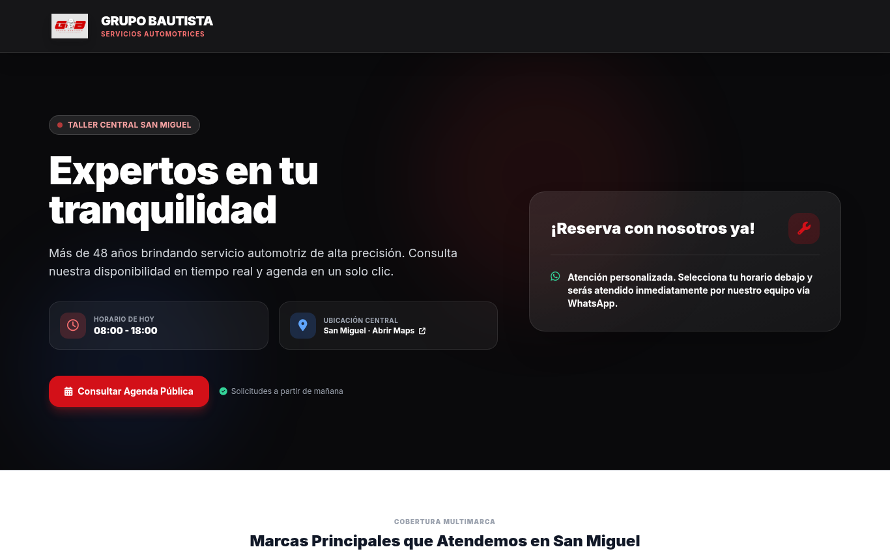
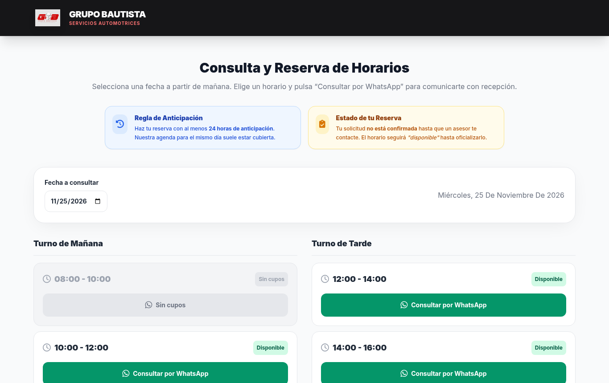
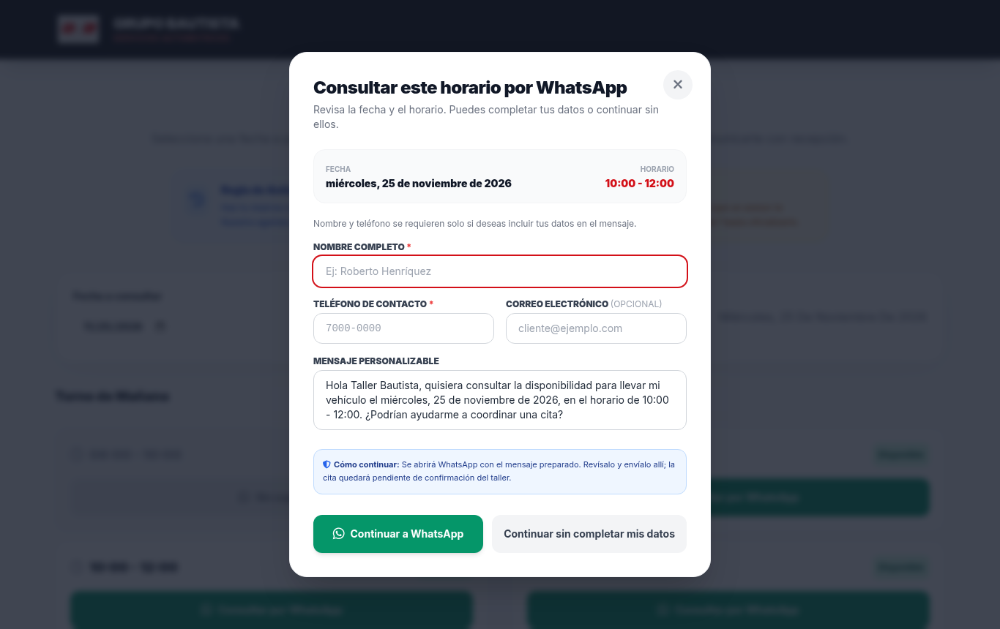
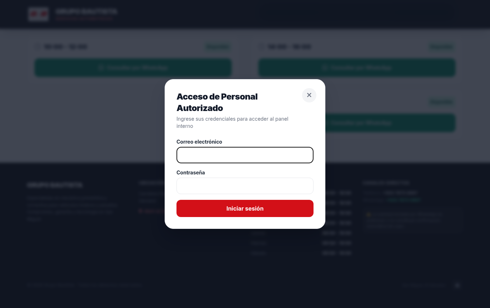
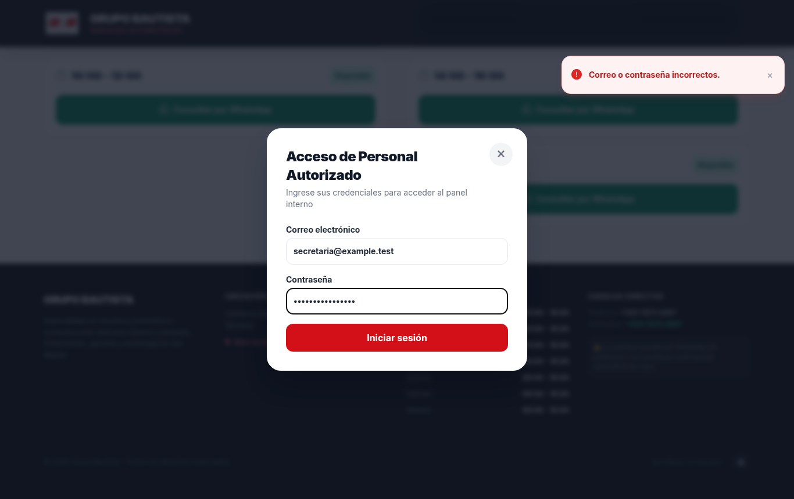
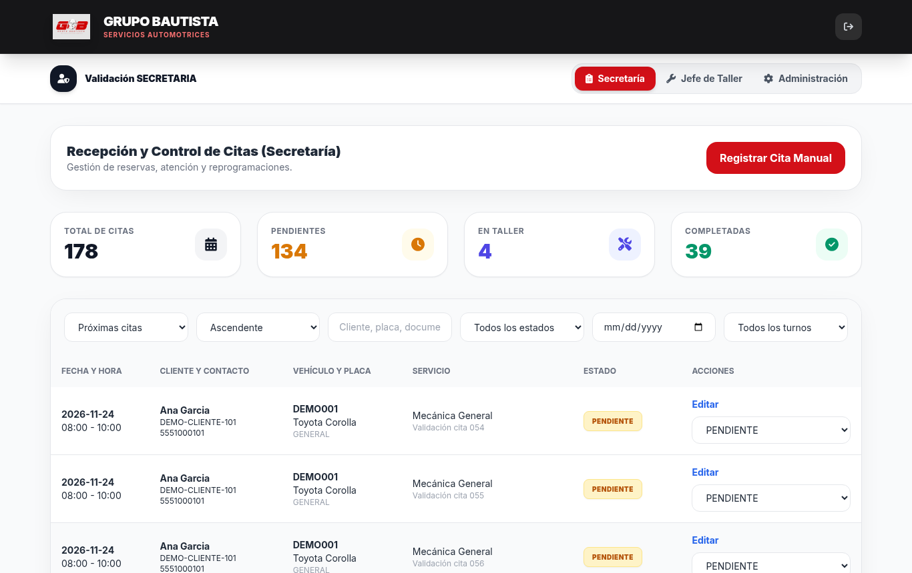
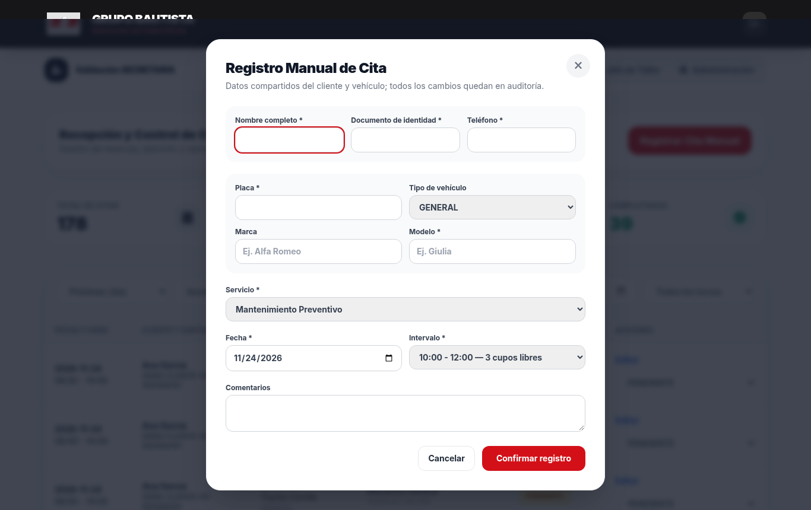
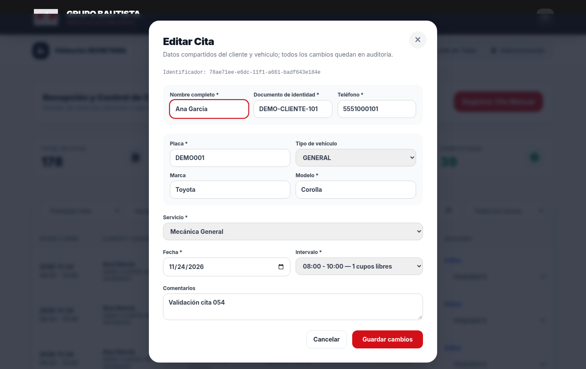
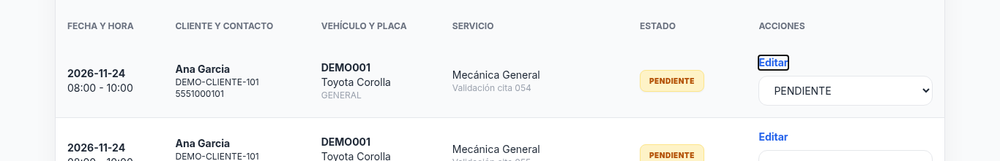
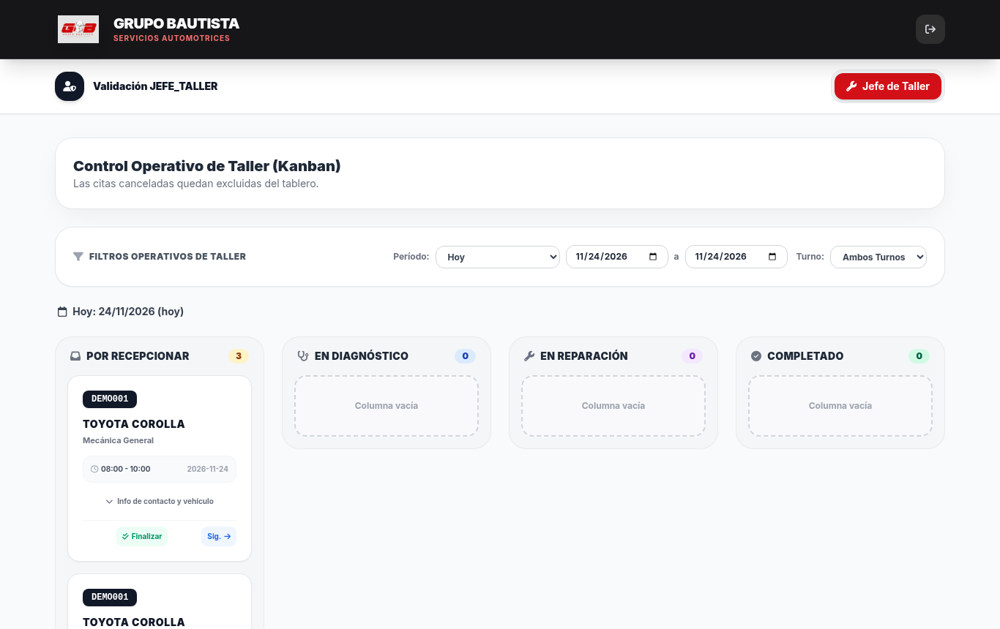

# Manual de usuario — Sistema de Reservas Grupo Bautista (V7.1)

Este manual explica cómo usar el sistema de reservas del taller **Grupo Bautista Servicios Automotrices**. Está escrito para clientes y para el personal del taller; no requiere conocimientos técnicos.

**Contenido**

1. Antes de empezar: cómo entrar al sistema
2. Quién hace qué (tipos de usuario)
3. Tareas del cliente
4. Tareas comunes del personal
5. Tareas de Secretaría
6. Tareas del Jefe de taller
7. Tareas del Administrador y del Dueño
8. Mensajes de error frecuentes y qué hacer
9. Preguntas frecuentes y glosario

---

## 1. Antes de empezar: cómo entrar al sistema

El sistema es una **página web**. No hay que instalar nada: se usa desde el navegador (Chrome, Edge, Firefox o Safari actualizados) en computadora, tableta o celular.

| Quién | Dirección | ¿Necesita cuenta? |
|---|---|---|
| Clientes | Dirección principal del sistema (por ejemplo `https://<dominio-del-taller>/`) | No |
| Personal del taller | La misma dirección; botón de candado en el pie de página, o directamente `https://<dominio-del-taller>/personal` | Sí: correo y contraseña |

> **Dirección pública:** al cierre de esta versión, la publicación en Railway está pendiente de configuración por el responsable del despliegue. Cuando quede activa, el taller comunicará la dirección definitiva. Mientras tanto, el equipo técnico puede ejecutar el sistema en una computadora local y abrirlo en `http://localhost:5173` (ver Manual técnico, sección 6).

**Cuentas del personal.** Cada empleado recibe su propia cuenta (correo y contraseña) de parte del administrador técnico. No existen contraseñas compartidas ni cuentas de prueba en producción. Para practicar en un entorno de demostración local, el equipo técnico puede cargar cuentas de ejemplo (`secretaria@example.test`, `jefe_taller@example.test`, `admin@example.test`); esas cuentas **nunca** deben existir en producción.

**Duración de la sesión.** La sesión del personal dura **8 horas**. Después hay que volver a iniciar sesión.

---

## 2. Quién hace qué (tipos de usuario)

| Tipo de usuario | Qué puede hacer |
|---|---|
| **Cliente** (sin cuenta) | Ver horarios disponibles y enviar una solicitud por WhatsApp. |
| **Secretaría** | Ver todas las citas, registrar citas manuales, editarlas, cancelarlas y reactivarlas, ver el tablero del taller y usar Administración (horarios, cierres y auditoría). |
| **Jefe de taller** | Ver el tablero del taller por fechas y mover cada vehículo entre estados. |
| **Administrador** y **Dueño** | Lo mismo que Secretaría: citas, tablero del taller y Administración (horarios, capacidad, cierres y auditoría). |

Las opciones que no corresponden a su rol no aparecen en pantalla.

---

## 3. Tareas del cliente

### 3.1 Cómo consultar los horarios disponibles

1. Abra la dirección del sistema. Verá la página de inicio del taller.

   

2. Pulse **Consultar Agenda Pública** o baje hasta la sección *Consulta y Reserva de Horarios*.
3. En **Fecha a consultar**, elija el día. Solo se pueden consultar fechas a partir de **mañana** (se requiere un mínimo de 24 horas de anticipación).
4. Revise los intervalos del **Turno de Mañana** y del **Turno de Tarde**:
   - **Disponible** (verde): hay espacio en ese horario.
   - **Sin cupos** (gris): el horario está lleno; elija otro.

   

### 3.2 Cómo solicitar una cita por WhatsApp

1. En un horario **Disponible**, pulse **Consultar por WhatsApp**.
2. Revise la fecha y el horario mostrados en la ventana.
3. Escriba su **nombre completo** (obligatorio). El teléfono y el correo son opcionales.
4. Si lo desea, ajuste el mensaje que se enviará.
5. Pulse **Continuar a WhatsApp**. Se abrirá WhatsApp con el mensaje listo; envíelo.
   - Si prefiere no escribir sus datos, use **Continuar sin completar mis datos**.

   

> **Importante:** enviar el mensaje **no reserva el cupo**. Su cita queda confirmada solo cuando el personal del taller le responde y la registra en el sistema. Mientras tanto, el horario puede seguir apareciendo como disponible para otras personas.

---

## 4. Tareas comunes del personal

### 4.1 Cómo iniciar sesión

1. Abra la dirección del sistema y pulse el **candado** del pie de página (*Acceso para empleados*), o abra directamente `/personal`.
2. Escriba su **correo electrónico** y su **contraseña**.
3. Pulse **Iniciar sesión**.

   

Si los datos no son correctos verá el mensaje *“Correo o contraseña incorrectos.”* Revise que no tenga activadas las mayúsculas y vuelva a intentar. Después de varios intentos fallidos el sistema bloquea el acceso durante 15 minutos.

### 4.2 Cómo moverse entre secciones

En la parte superior aparecen los botones de las secciones permitidas para su rol: **Secretaría**, **Jefe de Taller** y **Administración**. Pulse el que necesite.

### 4.3 Cómo cerrar sesión

Pulse el botón de salida (flecha) en la esquina superior derecha. Hágalo siempre al terminar, en especial en computadoras compartidas.

---

## 5. Tareas de Secretaría

La pantalla de Secretaría muestra arriba el resumen (**Total de citas**, **Pendientes**, **En taller**, **Completadas**) y abajo la lista de citas.

### 5.1 Cómo registrar una cita (reserva)

Use esta tarea cuando un cliente confirma por WhatsApp o por teléfono.

1. Pulse **Registrar Cita Manual**.
2. Complete los **datos del cliente**: nombre completo, documento de identidad y teléfono (obligatorios). El correo es opcional.
3. Complete los **datos del vehículo**:
   - **Placa** — obligatoria.
   - **Modelo** — obligatorio.
   - **Marca** — opcional.
   - **Tipo de vehículo** — General o Pesado.
4. Elija el **Servicio**.
5. Elija la **Fecha** y luego el **Intervalo**. La lista muestra cuántos cupos libres quedan en cada horario.
6. Si lo necesita, agregue **Comentarios**.
7. Pulse **Confirmar registro**. Aparecerá un aviso verde y la cita se agregará a la lista con estado **PENDIENTE**.

   

> **Cliente o vehículo que ya existen:** si escribe un documento o una placa ya registrados, el sistema reutiliza esos datos. Si deja la marca vacía, se conserva la marca guardada anteriormente.

### 5.2 Cómo registrar un servicio que no está en la lista (“Otros”)

1. En **Servicio**, elija **Otros**.
2. Aparecerá el campo **Descripción del servicio**. Escriba qué necesita el cliente (por ejemplo, *“Revisión del aire acondicionado”*). Es obligatorio y admite hasta **200 caracteres**.
3. Complete el resto y pulse **Confirmar registro**.

La descripción se verá debajo del servicio en la lista de citas y en el tablero del taller.

### 5.3 Cómo buscar una cita

En la barra de filtros sobre la lista puede combinar:

| Filtro | Para qué sirve |
|---|---|
| **Vista**: *Próximas citas* | Muestra desde hoy en adelante (vista inicial). |
| **Vista**: *Historial* | Muestra citas de días anteriores. |
| **Vista**: *Todas* | Muestra pasadas y futuras. |
| **Orden**: *Ascendente / Descendente* | Ascendente muestra primero la más cercana; descendente, la más lejana. |
| **Buscar** | Cliente, placa, documento o identificador. |
| **Estado** | Pendiente, en taller, completada o cancelada. |
| **Fecha** | Un día concreto. |
| **Turno** | Mañana o tarde. |

### 5.4 Cómo recorrer muchas citas (paginación)

Al final de la lista verá **Página X de Y** y el total de citas encontradas.

1. Use **Ant.** y **Sig.** para avanzar o retroceder, o los botones de primera y última página.
2. Para ir directo a una página, escriba el número en **Ir a página**.
3. En **Citas por página**, elija cuántas filas ver a la vez.

### 5.5 Cómo modificar o reprogramar una cita

1. Busque la cita y pulse **Editar** en la columna *Acciones*.
2. Cambie los datos necesarios: cliente, vehículo, servicio, fecha, intervalo o comentarios.
3. Pulse **Guardar cambios**.

> Si la cita está **cancelada**, primero reactívela (5.7) y después reprográmela.

### 5.6 Cómo cancelar una cita

1. Busque la cita.
2. En la lista desplegable de estado de la columna *Acciones*, elija **CANCELADO**.
3. La cita deja de ocupar cupo y desaparece del tablero del taller.

### 5.7 Cómo reactivar una cita cancelada

1. Use el filtro **Estado → Cancelada** para encontrarla.
2. En su lista desplegable de estado elija **PENDIENTE**.
3. Si el horario ya no tiene cupo, el sistema lo indicará; en ese caso, reprograme la cita a otro intervalo.

### 5.8 Horarios, cierres y auditoría

Secretaría también tiene acceso a **Administración**. Las tareas están en la sección 7.

---

## 6. Tareas del Jefe de taller

Al entrar, el tablero muestra automáticamente las citas de **hoy** (hora de El Salvador), organizadas en cuatro columnas: **Por recepcionar**, **En diagnóstico**, **En reparación** y **Completado**. Las citas canceladas no aparecen.

### 6.1 Cómo ver las citas de otro período

En **Período** elija una opción:

| Opción | Qué fechas muestra (ejemplo con hoy = 22/11/2026) |
|---|---|
| **Hoy** | 22/11/2026 |
| **Últimos 15 días** | 08/11/2026 al 22/11/2026 |
| **Próximos 15 días** | 22/11/2026 al 06/12/2026 |
| **Último mes** | El mes calendario anterior completo: 01/10/2026 al 31/10/2026 |
| **Próximo mes** | El mes calendario siguiente completo: 01/12/2026 al 31/12/2026 |
| **Personalizado** | Las fechas que usted elija en los campos *Desde* y *a* |

También puede filtrar por **Turno** (mañana, tarde o ambos).

Si en un rango personalizado la fecha inicial es posterior a la final, el sistema muestra un aviso y no consulta hasta que lo corrija.

### 6.2 Cómo avanzar un vehículo al siguiente estado

1. Ubique la tarjeta del vehículo (placa, modelo, servicio y horario).
2. Pulse **Sig.** para pasarlo a la siguiente columna: *Por recepcionar → En diagnóstico → En reparación → Completado*.
3. Si necesita ver el contacto del cliente o los datos del vehículo, pulse **Info de contacto y vehículo**.

### 6.3 Cómo marcar un trabajo como terminado

Pulse **Finalizar** en la tarjeta. La cita pasa directamente a **Completado**.

> El Jefe de taller no puede cancelar ni reactivar citas; eso lo hace Secretaría o Administración.

---

## 7. Tareas de Administración (Administrador, Dueño y Secretaría)

Pulse **Administración** en la parte superior. El Jefe de taller no ve esta sección.

### 7.1 Cómo configurar los horarios y la capacidad de cada día

1. En **Horarios y capacidad por día**, revise cada día de la semana.
2. Para cada día puede cambiar:
   - La casilla junto al nombre del día: marcada si el taller atiende ese día.
   - **Apertura** y **Cierre**.
   - **Minutos por bloque** (duración de cada intervalo).
   - **Capacidad** (vehículos que se pueden atender a la vez en un intervalo).
3. Pulse **Guardar semana**.

> Los siete días deben estar configurados antes de poder registrar citas. Si un cambio dejaría citas activas fuera del nuevo horario o sin capacidad, el sistema no lo aplica (ver sección 8).

### 7.2 Cómo cerrar la agenda un día (feriado, mantenimiento)

1. En **Cierres de agenda**, elija la **Fecha** y escriba el **Motivo público** (lo verán los clientes).
2. Pulse **Cerrar fecha**.
3. Ese día dejará de mostrar horarios disponibles a clientes y personal.

> Si ese día ya hay citas activas, primero reprográmelas o cancélelas.

### 7.3 Cómo retirar un cierre

En la lista de cierres programados, pulse **Retirar cierre** junto a la fecha. El día vuelve a estar disponible.

### 7.4 Cómo consultar la auditoría (historial de cambios)

La auditoría registra quién hizo cada cambio (crear, editar, cancelar, cambiar estado, configurar, exportar) y cuándo.

1. En **Auditoría de actividad**, elija **Desde** y **Hasta**. El rango máximo es de **30 días**.
2. Si lo necesita, filtre por **Acción**, **Módulo** o escriba un nombre o identificador en **Usuario o identificador**.
3. Recorra los resultados con **Anterior** y **Siguiente**.

### 7.5 Cómo exportar la auditoría a Excel

1. Aplique los filtros que desee.
2. Pulse **Exportar datos**. Se descargará un archivo **CSV** con **todos** los resultados filtrados (no solo la página visible).
3. Ábralo con Excel o Google Sheets. El archivo no incluye contraseñas ni datos sensibles.

---

## 8. Mensajes de error frecuentes y qué hacer

| Mensaje que aparece | Qué significa | Qué hacer |
|---|---|---|
| *Correo o contraseña incorrectos.* | Los datos de acceso no coinciden. | Revise mayúsculas y vuelva a escribirlos. Si olvidó la contraseña, pida al administrador técnico que la restablezca. |
| *Demasiados intentos. Espera 15 minutos.* | Se bloqueó el acceso tras varios intentos fallidos. | Espere 15 minutos y vuelva a intentar. |
| *Inicia sesión para continuar.* / *La sesión no es válida.* | La sesión venció (8 horas) o se cerró. | Vuelva a iniciar sesión. |
| *El origen de la solicitud no está permitido.* o error de seguridad (403) al guardar | La página quedó abierta mucho tiempo o se abrió desde otra dirección. | Recargue la página (F5) e inicie sesión de nuevo desde la dirección oficial. |
| *Faltan campos obligatorios.* o campo marcado en rojo | Falta un dato obligatorio. | Complete nombre, documento, teléfono, placa, modelo, servicio, fecha e intervalo. Con **Otros**, escriba la descripción. |
| *Un campo excede la longitud permitida.* | Un texto es demasiado largo (por ejemplo, la descripción de *Otros* supera 200 caracteres). | Acorte el texto. |
| *La placa pertenece a otro cliente. No se cambió su propietario.* | Esa placa ya está registrada a nombre de otra persona. | Verifique la placa y el documento del cliente. Si el vehículo cambió de dueño, avise al administrador. |
| *Ya existe un registro con esos datos.* | El correo o el documento ya pertenecen a otro cliente. | Busque al cliente existente y use sus mismos datos. |
| Aviso de **cupo lleno** / el intervalo no aparece | El horario ya alcanzó la capacidad. | Elija otro intervalo u otra fecha. |
| Aviso de **agenda cerrada** | El día tiene un cierre o el taller no atiende ese día. | Elija otra fecha o pida al administrador revisar los cierres. |
| *La cita cambió. Actualiza y vuelve a intentar.* | Otra persona modificó la misma cita al mismo tiempo. | Recargue la página, revise los datos y repita el cambio. |
| *Otra operación modificó la agenda…* / *La agenda está ocupada…* | Dos personas guardaron a la vez en el mismo horario. | Espere unos segundos y vuelva a intentar. |
| *Reactiva la cita antes de reprogramarla.* | Intentó cambiar fecha u hora de una cita cancelada. | Cámbiela a **PENDIENTE** y luego edítela. |
| *Solo recepción o administración pueden cancelar citas.* / *No tienes permiso para esta operación.* | Su rol no permite esa acción. | Pida a Secretaría o Administración que lo haga. |
| *Configura primero los siete días de la agenda.* | Falta configurar algún día de la semana. | Administración debe guardar los siete días (7.1). |
| *La configuración dejaría citas activas fuera de horario o sin capacidad.* | El nuevo horario o capacidad deja citas existentes sin lugar. | Reprograme o cancele esas citas, o use un horario que las incluya. |
| *Hay citas activas. Reprográmalas o cancélalas antes de cerrar la fecha.* | Intentó cerrar un día que ya tiene citas. | Reprograme o cancele las citas de ese día y vuelva a crear el cierre. |
| *Ya existe un cierre para esa fecha.* | Ese día ya está cerrado. | No hace falta crearlo de nuevo. |
| Aviso de **rango inválido** (taller o auditoría) | La fecha *Desde* es posterior a *Hasta*. | Corrija las fechas. |
| Aviso de **máximo 30 días** (auditoría) | El rango de auditoría supera 30 días. | Divida la consulta en períodos de 30 días o menos y exporte cada uno. |
| *La base de datos no está disponible.* / *Ocurrió un error interno.* | El servidor tiene un problema temporal. | Espere unos minutos y recargue. Si persiste, avise al equipo técnico indicando la hora y la acción que intentaba. |

---

## 9. Preguntas frecuentes y glosario

**¿Por qué no veo la sección Administración?** La ven Secretaría, Administrador y Dueño. El Jefe de taller no tiene acceso.

**¿Por qué la solicitud del cliente no aparece en la lista de citas?** Porque WhatsApp no crea citas automáticamente. Secretaría debe registrarla (5.1).

**¿Se pueden borrar citas?** No. Las citas se cancelan para conservar el historial.

**¿Puedo cambiar la auditoría?** No. La auditoría no se puede editar ni borrar.

| Término | Significado |
|---|---|
| **Intervalo** | Bloque de tiempo para atender un vehículo (por ejemplo 08:00 – 10:00). |
| **Capacidad / cupos** | Cuántos vehículos se pueden atender en el mismo intervalo. |
| **Cierre de agenda** | Día en que el taller no recibe citas. |
| **Estado** | Etapa de la cita: Pendiente (por recepcionar), En diagnóstico, En reparación, Completada o Cancelada. |
| **Auditoría** | Registro automático de quién hizo cada cambio y cuándo. |
| **CSV** | Archivo de tabla que se abre con Excel. |
